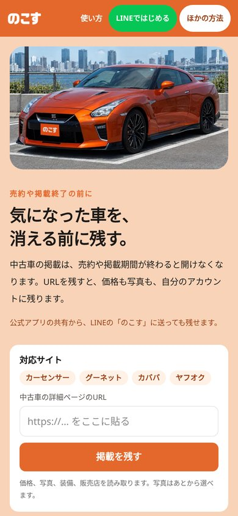
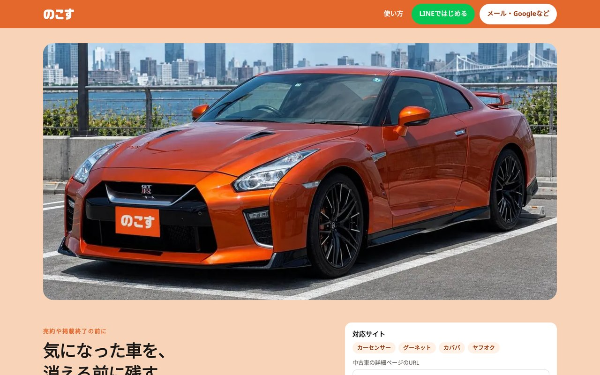

# のこす

**公開URL: https://fleet-maple-mto3zo3.vercel.app/**

気になった中古車の掲載を、売約や掲載終了で消える前に自分のアカウントへ残すメモアプリです。カーセンサー・グーネット・カババ・ヤフオクに対応しています。URLを貼るか、各サイトの共有からLINEの「のこす」に送るだけで、その時点の価格・写真・装備・販売店が残ります。保存した車は毎朝自動でチェックし、値下げや掲載終了をLINEでお知らせします。

| スマホ（幅390px） | パソコン（幅1280px） |
| --- | --- |
|  |  |

主な機能: URL・LINE共有からの保存、写真の選択保存、メモと検討状況、2〜3台の比較、毎朝の価格・掲載チェック、LINE通知、共有ページ（/s/…）。

使っている技術: Next.js（App Router）・Clerk（LINE / X / Google / Yahoo! / メールでログイン）・Vercel（ホスティングと毎朝のCron）・Cloudflare R2（保存先）・LINE Messaging API。

各サイトの公式サービスではありません。掲載の文章と写真の権利は、販売店・出品者と各サイトにあります。

## 使い方

1. 気になる車の詳細ページを開く。
2. アドレスバーのURL（`https://www.carsensor.net/usedcar/detail/AU…/index.html`）をコピーする。
3. のこすの入力欄に貼って、掲載を読み取る。
4. 残したい写真だけ選ぶ。関係ない写真は選ばない。

最初に「Googleで続ける」を押したGoogleアカウントが最初の利用者です。別のGoogleアカウントで開くと、その人だけの車になります。車はアカウントごとに分かれます。LINEからの共有は、最初のアカウントに残ります。同じアカウントを選べば、スマホでもパソコンでも同じ車が見えます。1台に残せる写真は40枚までです。

メモ、検討状況、2〜3台の比較、バックアップの書き出しと読み込みができます。以前このブラウザだけに残した車は、一覧の「アカウントに移す」から移せます。保存した車は毎日1回、掲載が続いているかと価格の変化を自動で確認します。選んだ写真は取り直しません。自動確認には `CRON_SECRET` が必要です。

## 開発

```bash
npm install
npm run dev
```

開発サーバーは [http://localhost:3000](http://localhost:3000) です。テストは `npm test` です。

保存のたびに、指定した1件の詳細ページだけを取得します。一覧の巡回や一括収集はしません。

公式アプリの共有ボタンから残すときは、LINE公式アカウント「のこす」に共有します。最初の1回だけGoogleアカウントとつなぐと、次からは送った時点で保存され、結果は車のカード1通で返ります。接続には `LINE_CHANNEL_SECRET` と `LINE_CHANNEL_ACCESS_TOKEN` が必要で、Webhook URL は `/api/line` です。

公開先は Vercel です。車の文章と選んだ写真は、ログインしたアカウントの保存先に残ります。写真の保存には Cloudflare R2（`R2_ACCOUNT_ID` `R2_BUCKET` `R2_ACCESS_KEY_ID` `R2_SECRET_ACCESS_KEY`）と、ログイン用の `AUTH_SECRET` が必要です。この二つが無いローカル実行では、`.data` フォルダに保存します。
